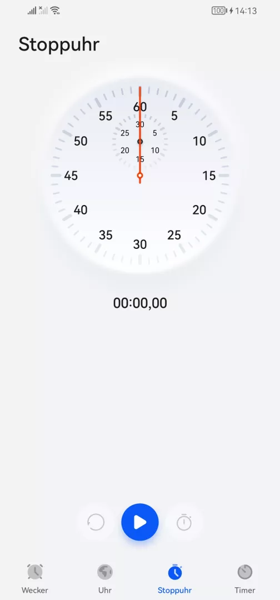
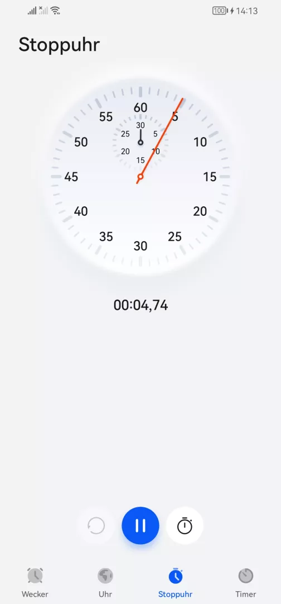
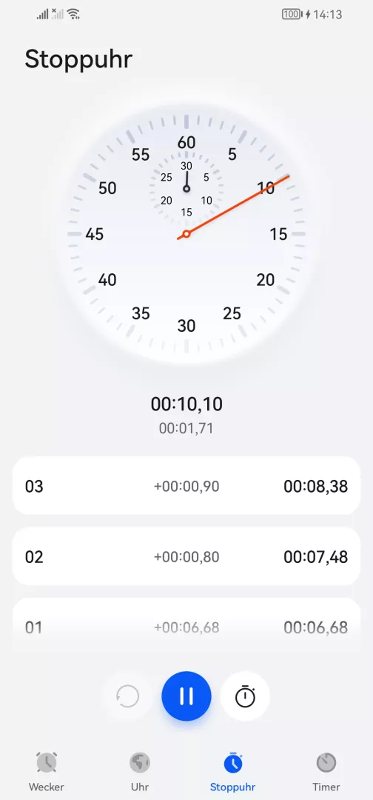
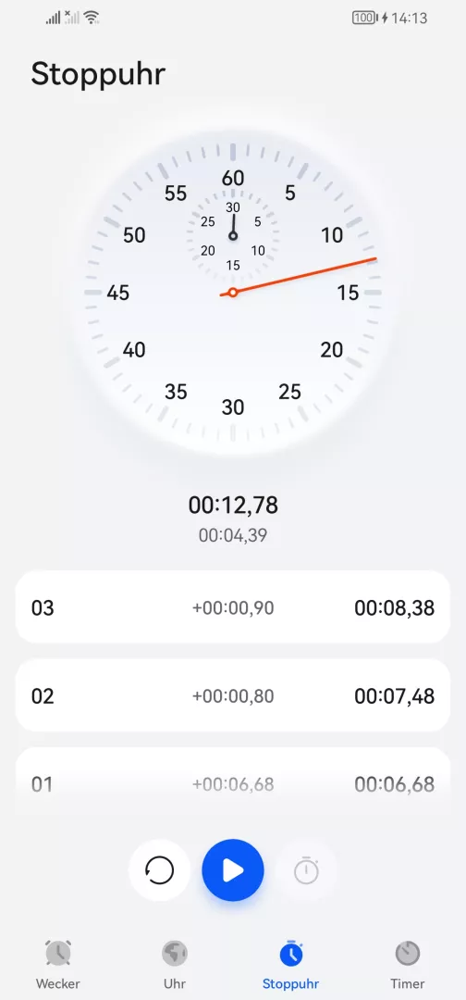

# Huawei

Android 10 y EMUI 12

Familia Huawei con EMUI 12. La documentación incluye P30, P40 y Mate 40 Pro, entre otros; terminal capturado no identificado.

## Look and feel

Esfera analógica prominente, graduaciones y aguja naranja, con volumen y sombra suaves. El dato digital queda debajo. Las vueltas forman tarjetas blancas sobre fondo claro.

## Elementos de pantalla

- Esfera analógica superior.
- Total digital y parcial activo debajo.
- Lista numerada de tiempos.
- Botón azul central y controles secundarios laterales.

## Funcionamiento

1. Abrir Reloj y entrar en Cronómetro.
2. Iniciar y registrar vueltas sin detener el total.
3. Pausar conserva la sesión; reanudar continúa; restablecer borra el total y las vueltas.

## Pantallas

### Inicio en cero

Esfera y reproducción central.

### Medición en marcha

Aguja desplazada y botón de pausa.

### Vueltas

Tarjetas de parciales y acumulado.

### Pausa

Tiempo retenido y reproducción disponible.

## Alcance

Capturas EMUI 12. No se trasladan a HarmonyOS NEXT ni a las familias Pura recientes.

## Fuentes

- [Secuencia de capturas](https://www.techbone.de/huawei/smartphone/stoppuhr)
- [Soporte oficial EMUI 11 y 12](https://consumer.huawei.com/uk/support/content/en-gb15769052/)