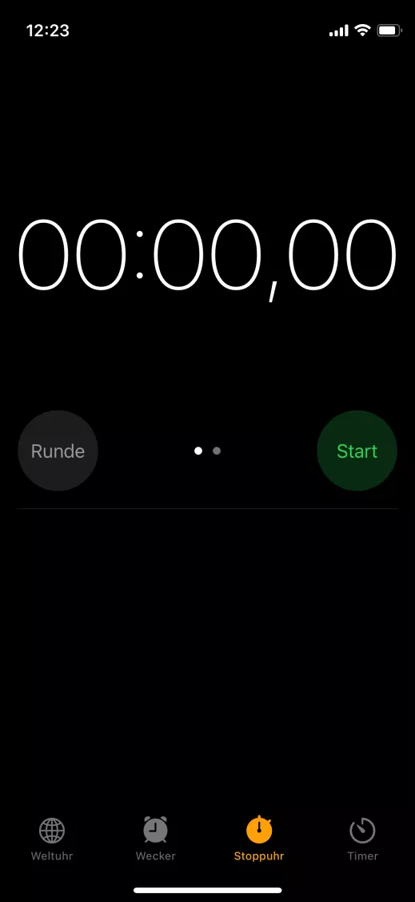
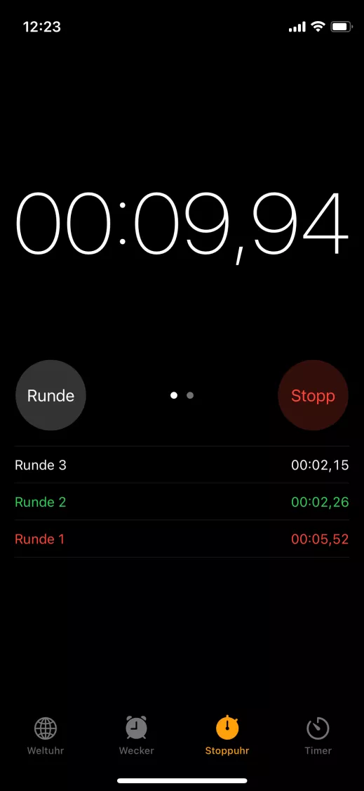
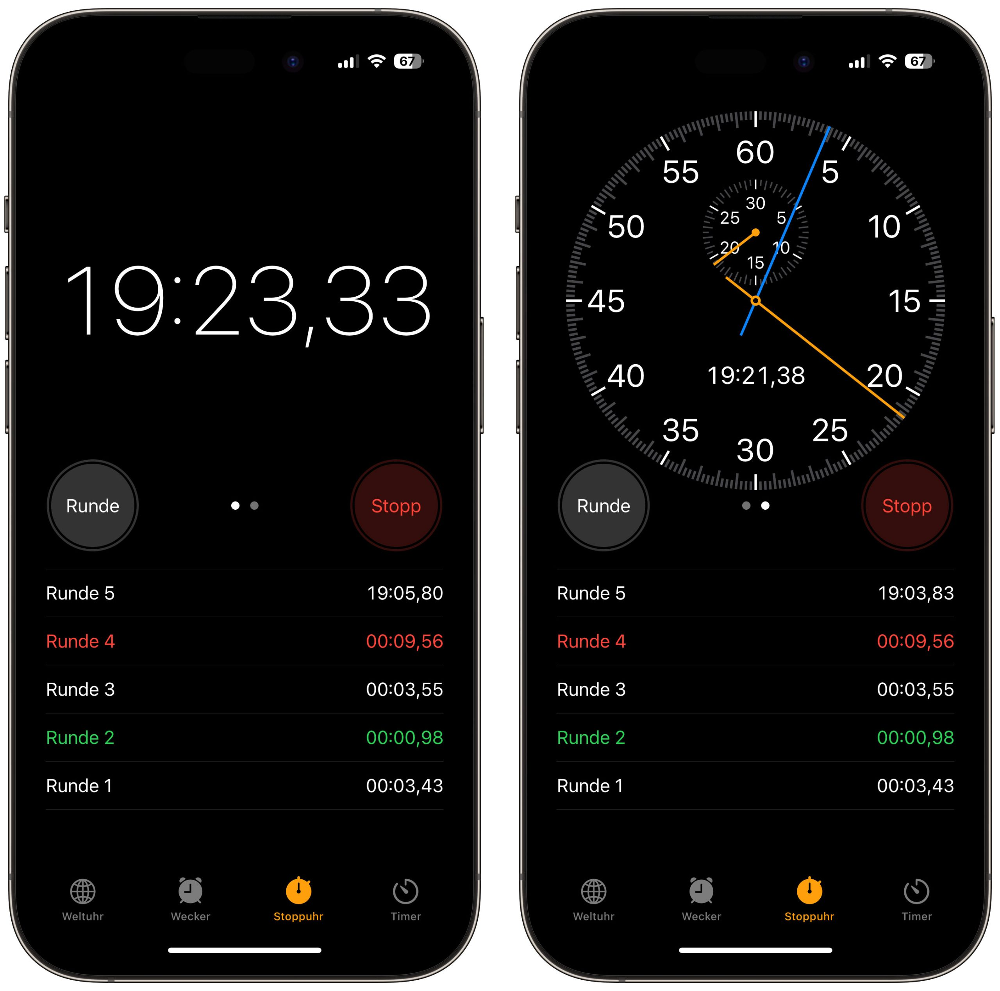
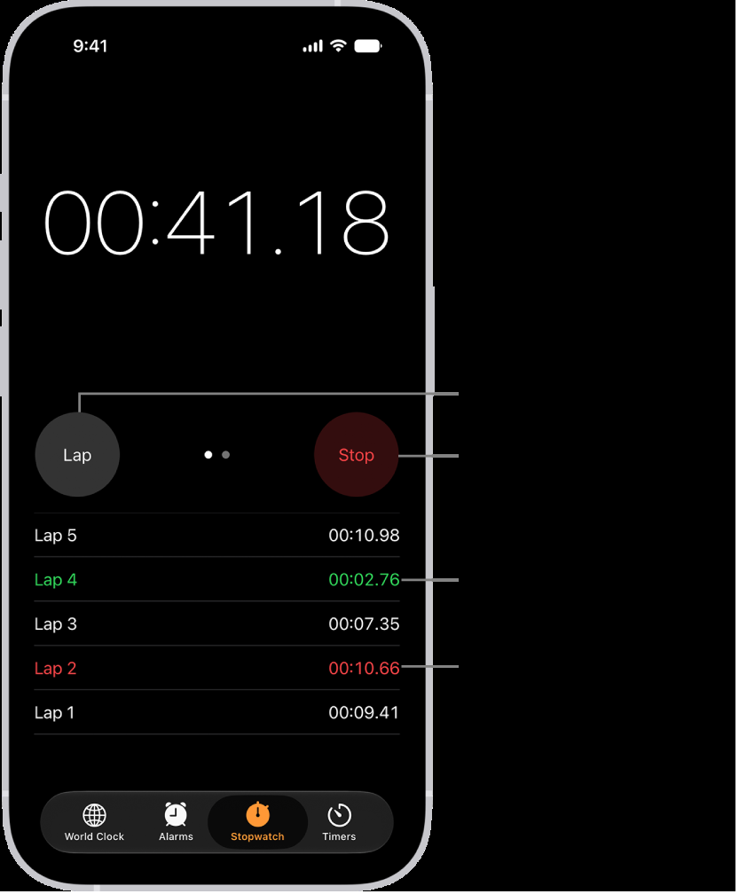

# Apple iPhone

iOS 17 en la secuencia principal

Familia iPhone. El terminal exacto de TechBone no está identificado.

## Look and feel

Fondo negro, cifras blancas muy finas y grandes, controles circulares y acento naranja. Verde para iniciar y rojo para detener. La lectura del tiempo domina la pantalla.

## Elementos de pantalla

- Tiempo total en la mitad superior.
- Dos botones: Vuelta y Start o Stopp.
- Lista inferior de vueltas con extremos verde y rojo.
- Dos puntos indican la alternativa digital o analógica.

## Funcionamiento

1. Abrir Reloj y entrar en Cronómetro.
2. Iniciar y registrar vueltas sin detener el total.
3. Pausar conserva la sesión; reanudar continúa; restablecer borra el total y las vueltas.
4. Deslizar horizontalmente cambia entre vista digital y analógica.

## Pantallas

### Inicio en cero

Vuelta desactivada y Start disponible.

### En marcha con vueltas

Stopp detiene; las vueltas permanecen debajo.

### Digital y analógico

Comparativa editorial de 2023 con marco del teléfono.

### Referencia de Apple

Imagen de documentación; no acredita iOS 17.

## Alcance

La secuencia iOS 17 cubre cero y marcha con vueltas, sin captura de pausa. La comparativa analógica es de febrero de 2023, sin versión exacta indicada. La imagen de la guía de Apple se incluye separadamente, sin atribuirla a iOS 17.

## Fuentes

- [Capturas iOS 17](https://www.techbone.de/apple/iphone/stoppuhr)
- [Funcionamiento oficial](https://support.apple.com/en-gb/guide/iphone/iph96b1e460/ios)
- [Comparativa analógica](https://www.iphone-ticker.de/in-ios-versteckt-iphone-stoppuhr-mit-runden-und-sekundenzeiger-207673/)