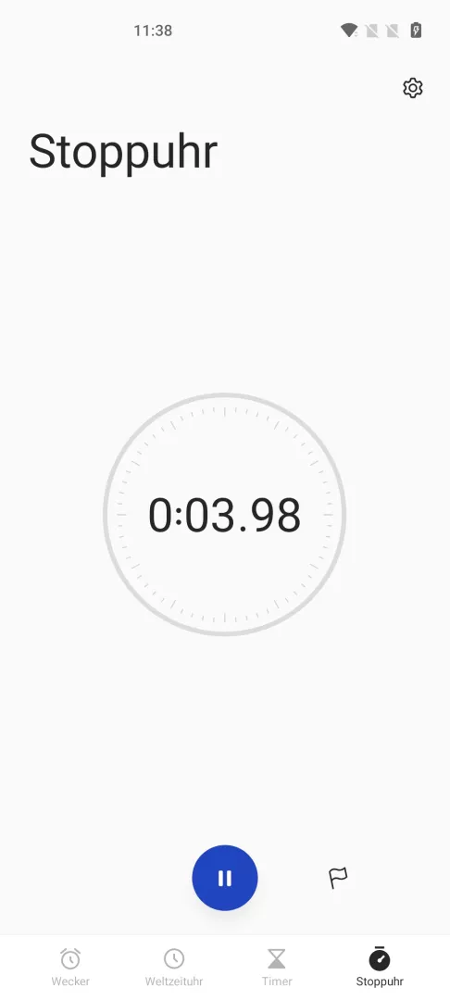
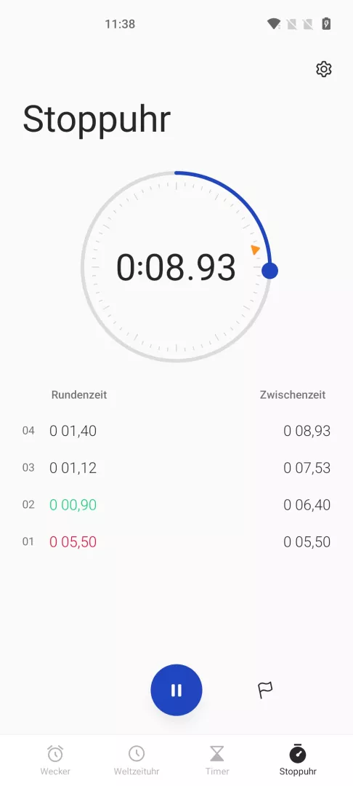
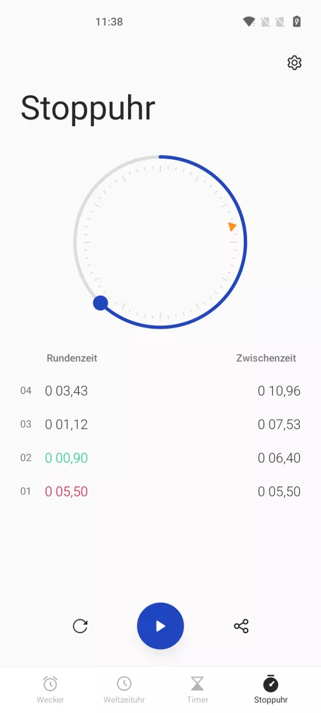

# OnePlus

Android 12 y OxygenOS 12

Familia OnePlus con esta versión de Reloj. Terminal capturado no identificado; no atribuir estas imágenes a OnePlus 13 o 15.

## Look and feel

Contador dentro de una esfera fina que se convierte en arco azul. Fondo claro, controles circulares y poco texto. Las vueltas también se distinguen por color.

## Elementos de pantalla

- Esfera con tiempo total.
- Tabla de duración y tiempo intermedio.
- Pausa central y bandera a la derecha.
- En pausa: restablecer, reproducir y compartir.

## Funcionamiento

1. Abrir Reloj y entrar en Cronómetro.
2. Iniciar y registrar vueltas sin detener el total.
3. Pausar conserva la sesión; reanudar continúa; restablecer borra el total y las vueltas.
4. El icono de compartir aparece en pausa; el manual de OnePlus también documenta compartir resultados.

## Pantallas

### Inicio en cero

Círculo con tiempo y reproducción azul.

### Medición en marcha

Pausa central y bandera lateral.

### Vueltas

Arco azul y tabla de parciales.

### Pausa y acciones

Restablecer, continuar y compartir.

## Alcance

Referencia histórica OxygenOS 12. No representa OxygenOS 16. No se capturó la hoja del sistema para compartir.

## Fuentes

- [Secuencia de capturas](https://www.techbone.de/oneplus/smartphone/stoppuhr)
- [Manual oficial OnePlus 10 Pro](https://service.oneplus.com/content/dam/support/user-manuals/common/OnePlus_10_Pro_User_Manual_EN.pdf)