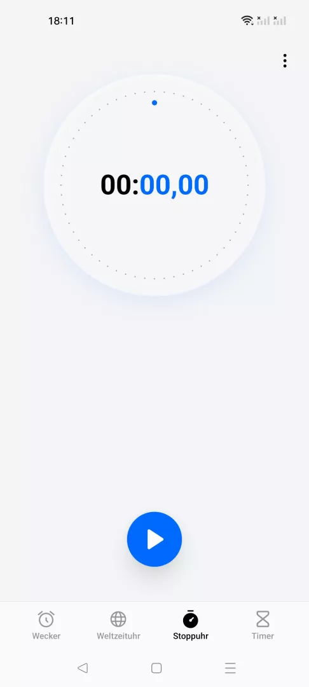
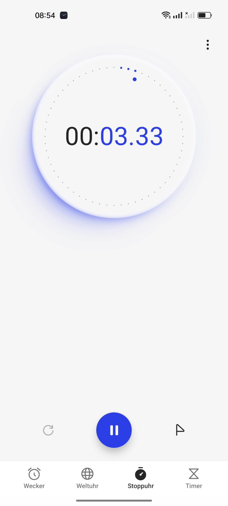
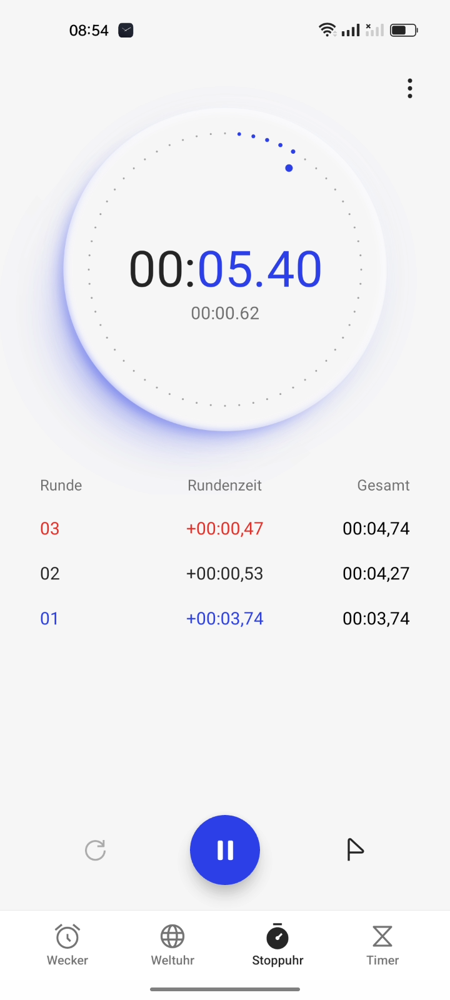

# OPPO

Android 13 y ColorOS 13

Familia OPPO con esta aplicación Reloj. Modelo exacto no identificado en la fuente.

## Look and feel

Esfera blanca con relieve y sombra azul violeta. El tiempo digital ocupa el centro; parte de sus dígitos se acentúa en azul. Combina una metáfora de instrumento físico y controles modernos.

## Elementos de pantalla

- Esfera grande con marcas discretas.
- Pausa azul central y bandera lateral.
- Restablecimiento con flecha circular.
- Tabla de vuelta, duración y total; extremos coloreados.

## Funcionamiento

1. Abrir Reloj, entrar en Cronómetro e iniciar con el triángulo.
2. En marcha, la bandera añade vueltas y pausa detiene la medición.

## Pantallas

### Inicio en cero

Esfera y reproducción azul.

### Medición en marcha

Restablecer, pausa y bandera.

### Vueltas

Tabla bajo la esfera y parcial actual.

## Alcance

Marcha y vueltas proceden de la secuencia ColorOS 13 archivada en la misma página. No hay captura independiente de pausa. No representan ColorOS 15 o 16.

## Fuentes

- [Guía y capturas ColorOS 13](https://www.techbone.de/oppo/smartphone/stoppuhr)
- [Manual oficial ColorOS 7 como antecedente](https://ipics.oppo.com/oppo_nl/answer/06_2020_DE_ColorOS7_v.4.5.2.pdf)