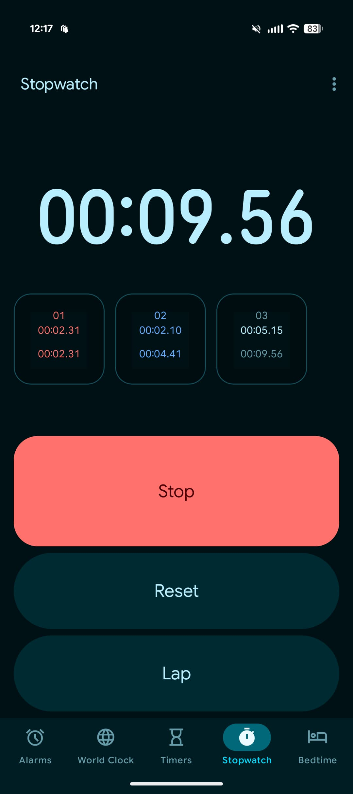
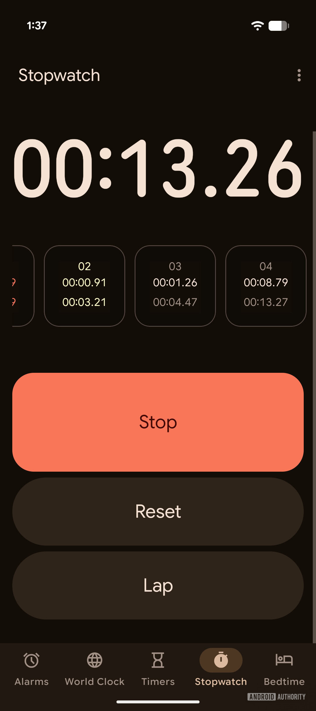
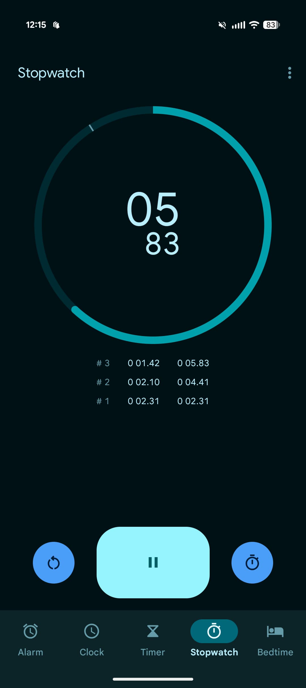

# Google Pixel

Google Clock 8.1 y Material 3 Expressive

Familia Pixel y otros Android con Google Clock. Modelos exactos capturados no identificados.

## Look and feel

Tema oscuro, cifras prominentes, botones muy grandes apilados y esquinas redondeadas. Las vueltas se agrupan en tarjetas. Las capturas Expressive muestran dos paletas diferentes.

## Elementos de pantalla

- Contador digital en la zona superior.
- Tarjetas numeradas para parciales.
- Stop, Reset y Lap ocupan el ancho inferior.
- Navegación inferior con cinco secciones.

## Funcionamiento

1. Entrar en Stopwatch desde la barra inferior.
2. La captura Expressive muestra una sesión activa con vueltas y acciones Stop, Reset y Lap.
3. La referencia anterior presenta pausa central y acciones laterales con iconos.

## Pantallas

### Expressive con vueltas

Publicada el 22 de agosto de 2025.

### Expressive en otra paleta

Segunda captura de Android Authority.

### Diseño anterior Material You

Anillo e iconos; no pertenece a la secuencia 8.1.

## Alcance

Cobertura parcial: no hay capturas independientes de cero ni pausa en Clock 8.1. Material You se incluye para comparar; su versión exacta no está identificada. No se afirma que 8.1 sea la versión más reciente en noviembre de 2026.

## Fuentes

- [Rediseño y capturas](https://9to5google.com/2025/08/22/google-clock-material-3-expressive/)
- [Segunda paleta](https://www.androidauthority.com/google-clock-expressive-release-3590370/)
- [Despliegue](https://9to5google.com/2025/08/27/google-clock-material-3-expressive-redesign/)