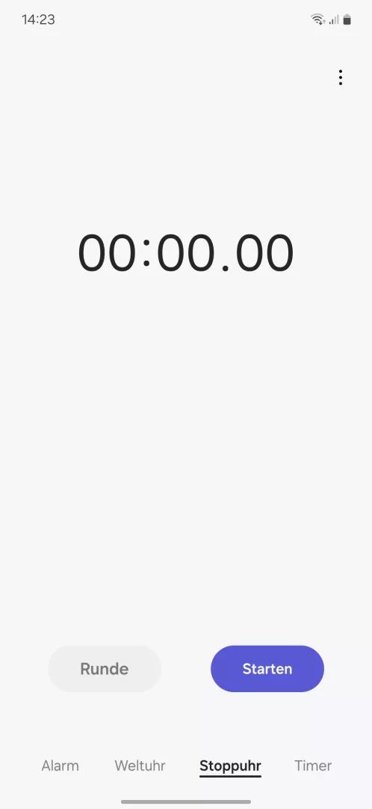
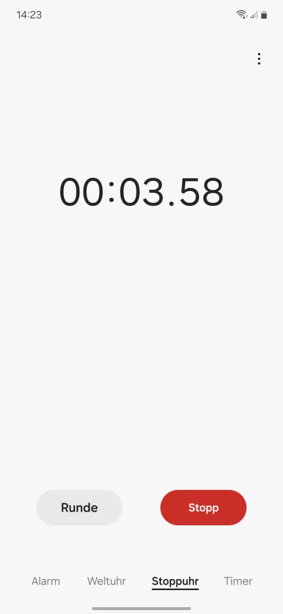
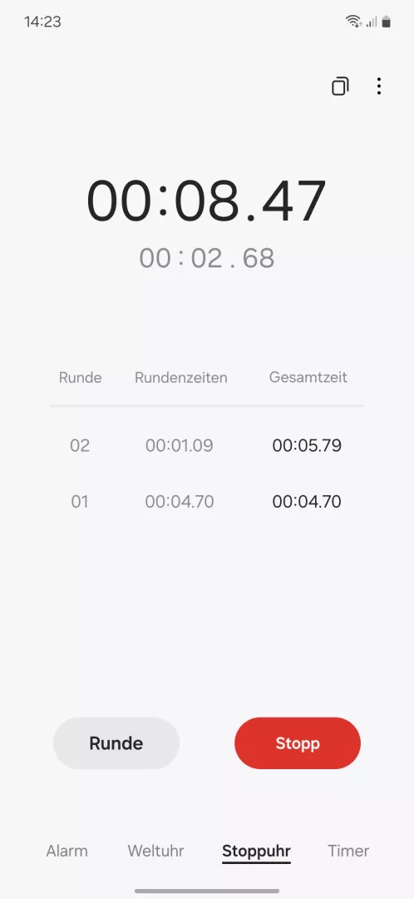
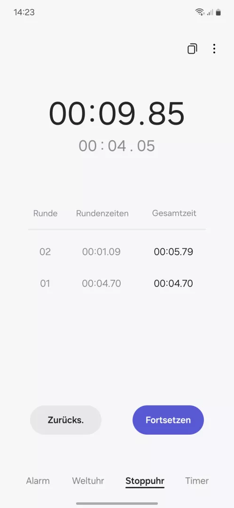

# Samsung Galaxy

Android 14 y One UI 6

Familia Galaxy. La guía vincula Galaxy S24 Ultra y A55, entre otros; no identifica el terminal capturado.

## Look and feel

Interfaz clara y sobria, mucho espacio vacío y contador centrado. Botones bajos en forma de pastilla; acción principal violeta al iniciar o continuar y roja al detener.

## Elementos de pantalla

- Total grande y parcial actual más pequeño.
- Tabla de vuelta, duración y acumulado.
- Controles laterales con texto.
- Pestañas inferiores subrayadas y acceso superior a copiar con vueltas.

## Funcionamiento

1. Abrir Reloj y entrar en Cronómetro.
2. Iniciar y registrar vueltas sin detener el total.
3. Pausar conserva la sesión; reanudar continúa; restablecer borra el total y las vueltas.

## Pantallas

### Inicio en cero

Runde inactivo y Starten disponible.

### Medición en marcha

Runde y Stopp son las acciones principales.

### Vueltas registradas

Tabla de parciales y tiempo acumulado.

### Pausa y reanudación

Zurücks. restablece; Fortsetzen continúa.

## Alcance

Referencia visual One UI 6. No se presenta como captura de One UI 8 ni como prueba específica de un Galaxy S26.

## Fuentes

- [Secuencia de capturas](https://www.techbone.de/samsung/galaxy/stoppuhr)
- [Soporte oficial](https://www.samsung.com/ae/support/mobile-devices/what-are-the-features-of-the-samsung-clock/)