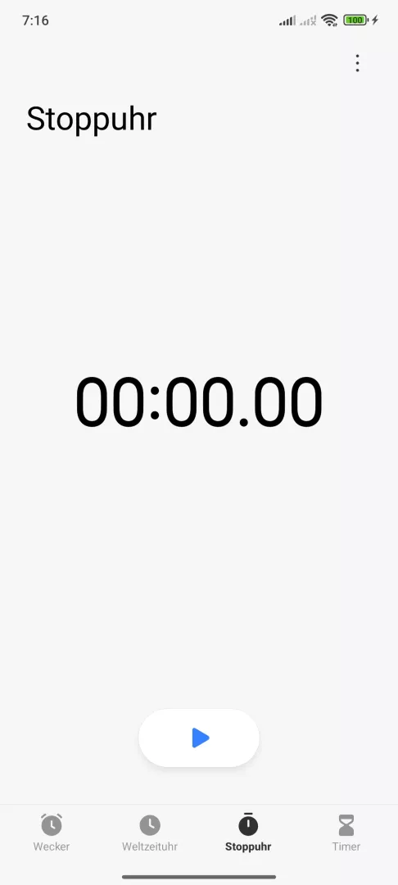
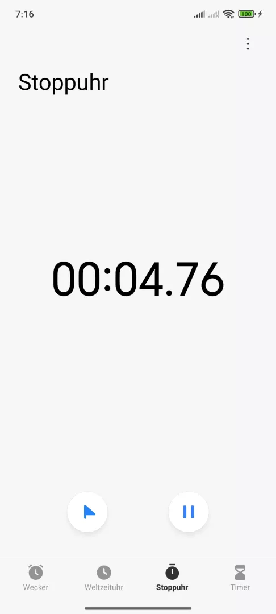
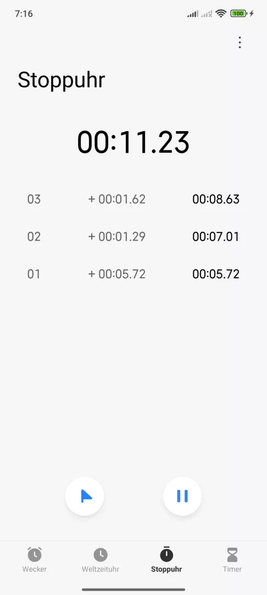
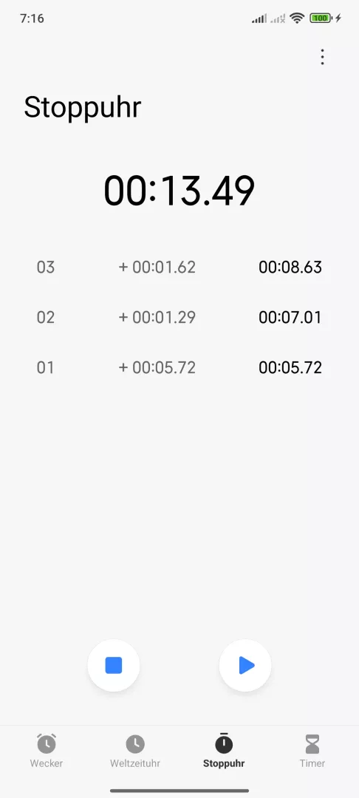

# Xiaomi Redmi y POCO

Android 15 y HyperOS 2

La guía vincula Xiaomi 14 Ultra y Redmi Note 13 Pro 5G, entre otros. POCO requiere comprobar la app instalada; terminal capturado no identificado.

## Look and feel

Fondo claro, cifras negras de peso marcado y acciones azules con iconos. La pantalla inicial dedica casi todo el espacio al contador; con vueltas, el total sube.

## Elementos de pantalla

- Título superior y menú de tres puntos.
- Contador y lista de vuelta, parcial y acumulado.
- Bandera y pausa durante la marcha.
- Cuadrado para restablecer y triángulo para continuar.

## Funcionamiento

1. Abrir Reloj y entrar en Cronómetro.
2. Iniciar y registrar vueltas sin detener el total.
3. Pausar conserva la sesión; reanudar continúa; restablecer borra el total y las vueltas.

## Pantallas

### Inicio en cero

Reproducción azul en una pastilla blanca.

### Medición en marcha

Bandera y pausa separadas.

### Listado de vueltas

Parciales y acumulados bajo el total.

### Pausa

Restablecimiento y reproducción.

## Alcance

Capturas HyperOS 2; no se extrapolan a HyperOS 3. Pertenecer a Xiaomi, Redmi o POCO no garantiza idéntica aplicación o versión.

## Fuentes

- [Secuencia de capturas](https://www.techbone.de/xiaomi/smartphone/stoppuhr)
- [Manual oficial HyperOS](https://gl123.alsgp0.mi-fds.com/gl123/Generic%20User%20Guide%20for%20HyperOS/Generic%20User%20Guide%20for%20HyperOS-ES%28LA%29.pdf)